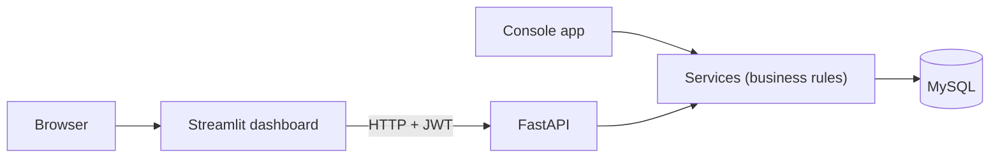
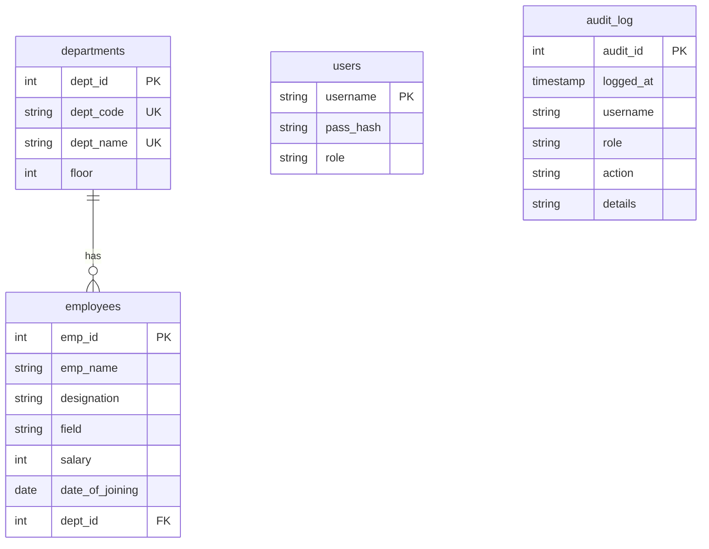
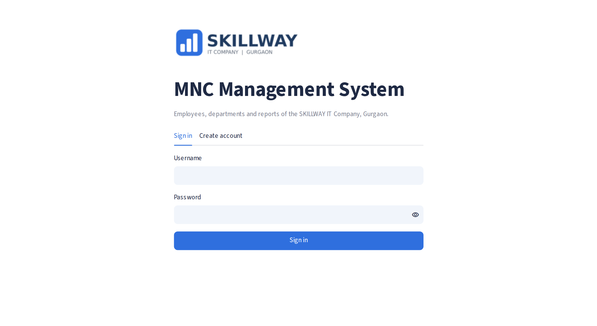
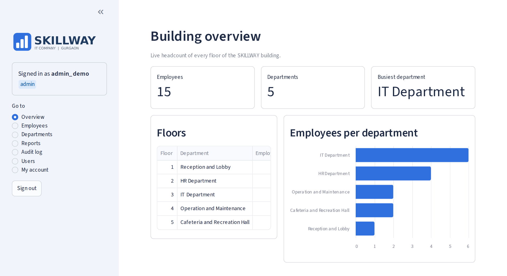
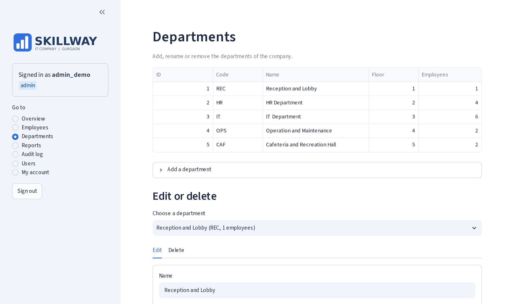
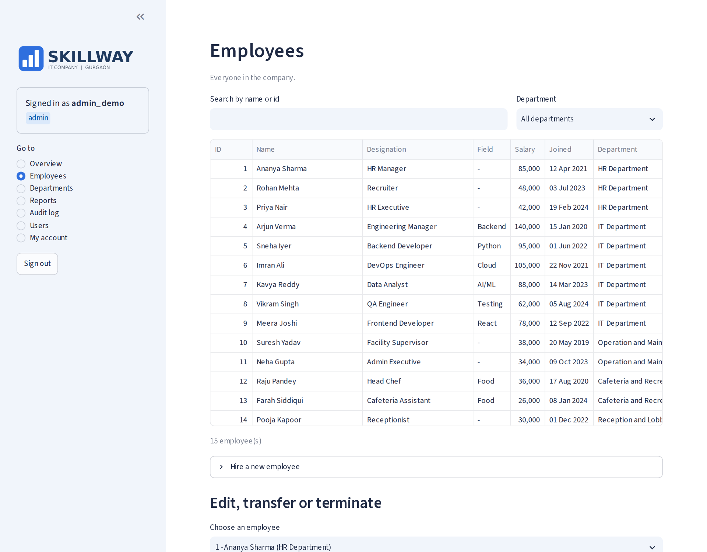
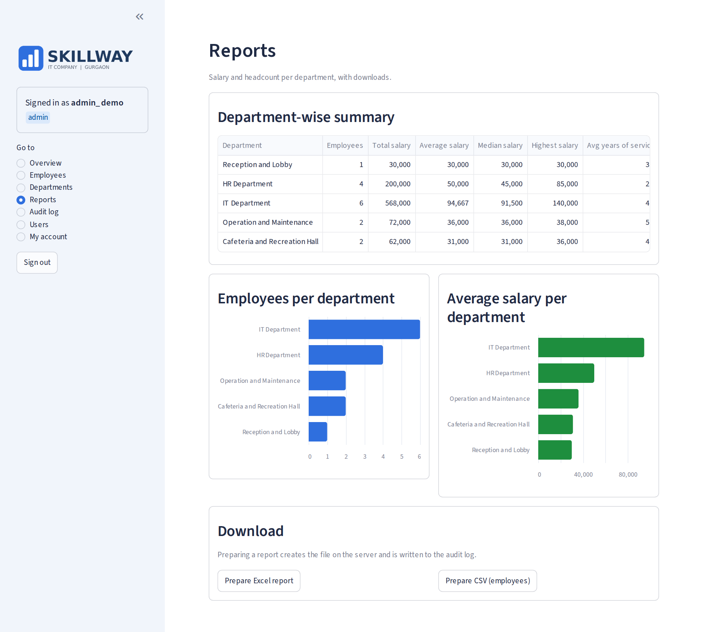
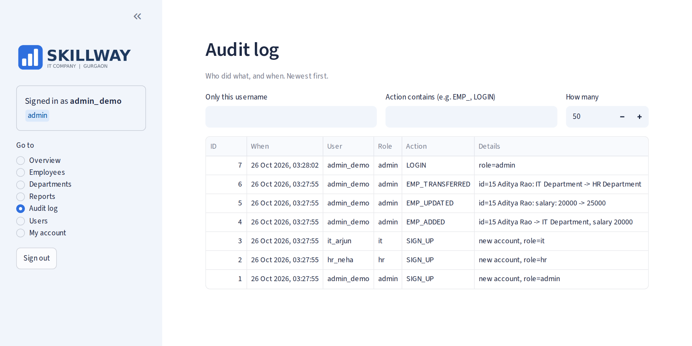
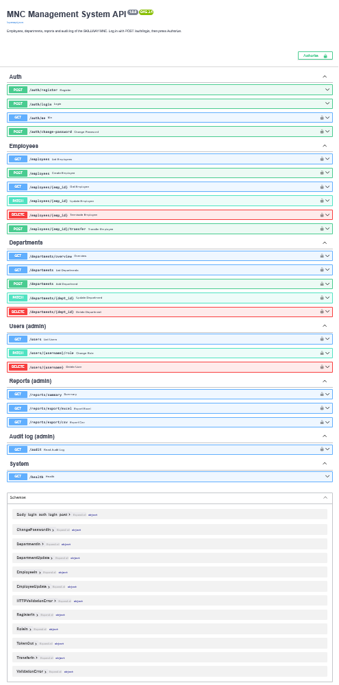

# MNC Management System

[](https://github.com/sheemashariq1/MNC_Management_System/actions/workflows/tests.yml)

An employee, department and reporting system for a fictional IT company (**SKILLWAY**, Gurgaon):
a **FastAPI** REST API, a **Streamlit** dashboard and the original **console app**, all sharing one
set of business rules on top of a normalised **MySQL** database.

It started as a Class 12 school project (a single console script with MySQL) and was rebuilt step by
step: fixed bugs and SQL injection, normalised the schema, added real authentication and roles, an
audit trail, reports, an API, a web dashboard, tests, CI and Docker.

## Features

- **Employees and departments**: hire, edit, transfer, terminate, search; live headcount per floor
- **Roles**: `admin`, `hr`, `it`. HR and IT only ever see their own department
- **Login with JWT**, bcrypt-hashed passwords, brute-force lockout (5 wrong passwords = 15 minutes)
- **Audit log**: who changed what, when (old value to new value), including failed logins
- **Reports**: department-wise salary summary (pandas), charts, Excel and CSV export
- **Three ways to use it**: web dashboard, REST API (interactive docs at `/docs`), terminal menu
- **178 automated tests** and a GitHub Actions workflow that runs them against a real MySQL

## Architecture



Every screen (dashboard, API routes, console menus) calls the **services**. Services contain the
rules and the SQL, and never print or ask for input, so the same logic is used (and tested) once.

## Database



The foreign key means an employee can only belong to a department that exists, and a department
that still has employees cannot be deleted. (The console app also keeps small `SERVICES`, `GAMES`
and `RESTAURANT` tables for the building's operations and cafeteria.)

## Who can do what

| | admin | hr | it |
|---|---|---|---|
| Building overview, own password | yes | yes | yes |
| Employees | all departments | HR only | IT only |
| Departments (add, edit, delete) | yes | no | no |
| Reports, Excel / CSV export | yes | no | no |
| Audit log | yes | no | no |
| User accounts (roles, delete) | yes | no | no |

The sign-up **access code** decides the role: there is one code per role, kept in `.env`.

## API

Interactive documentation: <http://localhost:8000/docs>. Log in with `POST /auth/login`, then press **Authorize**.

| Area | Endpoints |
|---|---|
| Auth | `POST /auth/register`, `POST /auth/login`, `GET /auth/me`, `POST /auth/change-password` |
| Employees | `GET /employees`, `GET /employees/{id}`, `POST /employees`, `PATCH /employees/{id}`, `POST /employees/{id}/transfer`, `DELETE /employees/{id}` |
| Departments | `GET /departments/overview`, `GET /departments`, `POST /departments`, `PATCH /departments/{id}`, `DELETE /departments/{id}` |
| Users (admin) | `GET /users`, `PATCH /users/{username}/role`, `DELETE /users/{username}` |
| Reports (admin) | `GET /reports/summary`, `GET /reports/export/excel`, `GET /reports/export/csv` |
| Audit (admin) | `GET /audit` |
| System | `GET /health` |

23 operations in total. Errors are clean JSON with the right status code (400, 401, 403, 404, 409, 422, 429).
Employee and audit-log lists are paged with `limit` and `offset`; the total number of matches comes back in the `X-Total-Count` header.

## Security

- **SQL injection**: every value goes through `%s` placeholders; the only column names put into SQL
  come from a whitelist
- **Passwords**: bcrypt with a per-password salt; old PBKDF2 accounts are upgraded on their next login
- **JWT**: signed (HS256 only, so `alg=none` tokens are rejected), expiring; the token holds only the
  username, and the **role is read from the database on every request**, so a role change or a
  deleted account takes effect immediately
- **Least privilege**: roles are enforced in the menus, in the service entry points and in the API
- **Brute force**: lockout after 5 failed logins, counted in the audit log
- **Secrets** live in `.env` (never in Git or in the Docker image); the server refuses to start
  without a strong `JWT_SECRET`
- **Safe deletes**: the last admin cannot be removed or demoted, nobody can delete their own account

## Testing

```
python -m pytest
```

178 tests, run against their own `MNC_test` database (your real data is never touched):

- services: validation, SQL-injection attempts, all-or-nothing updates, last-admin rules, lockout
- API: every endpoint, tokens (forged, expired, unsigned, deleted user), role scoping, error codes
- dashboard: the real Streamlit script is driven headlessly with `AppTest` (login, forms, role menus)
- concurrency: 20 threads writing at once through one shared connection

## Quick start

You need a `.env` file first:

```
cp .env.example .env        # on Windows: copy .env.example .env
python -c "import secrets; print(secrets.token_hex(32))"      # paste the output as JWT_SECRET
```

Set `MYSQL_PASSWORD`, `JWT_SECRET` and the three `*_ACCESS_CODE` values in `.env`.

### With Docker (everything in one command)

```
docker compose up --build
```

- Dashboard: <http://localhost:8501>
- API docs: <http://localhost:8000/docs>
- Console app: `docker compose run --rm cli`
- Stop: `docker compose down` (add `-v` to also delete the database)

### Without Docker

Needs Python 3.12+ and a running MySQL server.

```
python -m venv .venv
.venv\Scripts\activate                 # macOS / Linux: source .venv/bin/activate
python -m pip install -r requirements.txt

python -m uvicorn api.main:app --reload            # terminal 1: API
python -m streamlit run dashboard/app.py           # terminal 2: dashboard
python MNC.py                                      # optional: console app
```

Create the first account on the dashboard's **Create account** tab using your `ADMIN_ACCESS_CODE`.

If you still have data from the very first version (tables `HRdept` and `ITdept`), run
`python migrate_legacy_tables.py` once.

## Project structure

```
MNC.py                  console app entry point
api/                    FastAPI: main.py, security.py (JWT), deps.py, schemas.py, errors.py, routers/
dashboard/              Streamlit: app.py, api_client.py (only file that calls the API), screens/, assets/
services/               business rules: auth, employee, department, user (no input() / print())
database.py             connection pool, run() / fetch() helpers
schema.py               all tables, created automatically
config.py  session.py   settings from .env; who is logged in (per request) and what they may do
audit.py  reports.py    audit trail; pandas reports, charts, exports
login.py  users.py  employees.py  administration.py     console screens
helpers.py  logger.py   input checks and table printing; rotating log file
migrate_legacy_tables.py one-time migration from the old HRdept / ITdept tables
tests/                  178 tests
Dockerfile  docker-compose.yml  requirements.txt  requirements.lock.txt  .env.example
.github/workflows/      CI: runs the tests on every push
demo_data.py            fills an empty database with 14 sample employees (for demos)
```

## Design decisions

- **Services layer.** The console menus, the API and the tests all call the same functions, so a
  rule exists in exactly one place.
- **Connection pool.** The app keeps a few database connections open (5 by default, set with `MYSQL_POOL_SIZE` in `.env`) and every query borrows one. When all of them are busy, the next query waits for a free one. The last inserted id is kept per thread so concurrent requests cannot mix them up.
- **Per-request user (`ContextVar`).** The audit log and permission checks need to know the current
  user; a plain global would leak between simultaneous API requests.
- **Dashboard talks to the API only**, never to the database, so permissions are enforced in one place.

## Known limitations and next steps

- No HTTPS, refresh tokens or per-IP rate limiting (put it behind a reverse proxy for real use)
- The API pages employees and the audit log; the department and user lists are short and are not paged
- Schema changes are done by small upgrade functions; a migration tool (Alembic) would be better
- Dashboard login is lost on browser refresh (the token lives in Streamlit's session)

## Screenshots










## Author

Built by Sheema Shariq ([@sheemashariq1](https://github.com/sheemashariq1)).
